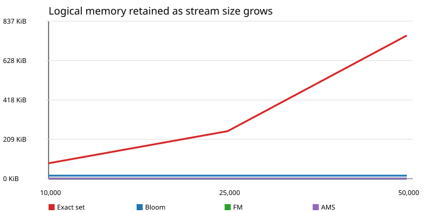

# Week 7: Mining Data Streams

## Goal

Chapter 4 asks how to answer questions about a stream that may be too large,
fast, or long-lived to save in full.  This week implements four small
summaries (also called *sketches*) and checks every approximate answer against
an exact finite-stream answer.  The work deliberately uses a generated click
event stream so that the ground truth and random seed are known; it does not
claim to be a production streaming platform or a Hadoop performance benchmark.

## Questions and algorithms

| Question | Algorithm | Stored summary | Important limitation |
| --- | --- | --- | --- |
| Has this user probably appeared before? | Bloom filter | Fixed bit array | A positive can be false; a negative cannot. |
| How many distinct users have appeared? | Flajolet--Martin (FM) | Fixed hash-register array | Estimate, not an exact count. |
| Is traffic evenly spread or dominated by a few users? | AMS second-moment estimator | Fixed set of reservoir-selected counters | Estimate has random error. |
| How many errors occurred recently? | DGIM | Exponentially sized time buckets | Recent-count estimate has bounded approximation error. |

The event model is a JSON line with a sequence number, user ID, page ID, and
HTTP-style status.  A `500` status becomes a one-bit error event for DGIM.
`event_generator.py` yields records one at a time, so generating the stream
does not require it to be stored first.

## Local implementation and verification

`scripts/streaming.py` contains the four sketches and exact reference helpers.
The reference answer intentionally retains the finite stream in local memory;
that is appropriate only for testing.  The sketches themselves retain fixed or
logarithmic-sized summaries as events arrive.

Run the local tests:

```bash
python3 -m unittest discover -s week-07/tests -v
```

Run a reproducible experiment; the JSON result is local evidence and is
ignored by Git:

```bash
python3 week-07/scripts/run_experiment.py \
  --events 10000 --users 1000 --pages 100 --seed 4099 \
  --output runtime/week-07/ten-thousand.json
```

### Representative local result

The command above was run on the development workstation.  It processed
10,000 generated events with 1,000 exact distinct user IDs.  The result is
evidence that the code runs and reports its uncertainty; it is not a hardware
comparison with Hadoop.

| Summary | Exact answer / check | Measured estimate | Logical sketch memory |
| --- | ---: | ---: | ---: |
| Bloom filter | 1,000 inserted users had no false negatives | 0.0% positives on 1,000 known-absent probes | 16,384 bytes |
| FM distinct users | 1,000 | 1,015.6 (1.56% error) | 128 bytes |
| AMS second moment | 109,934 | 109,687.5 (0.22% error) | 1,024 bytes |
| DGIM recent errors | 35 in the last 1,024 events | 46 (31.43% error) | 144 bytes |

The low-probability error stream makes the DGIM percentage look large: an
absolute difference of 11 events is within the method's intended rough
approximation.  A later run should repeat seeds and report a range, rather
than treating one generated stream as a universal accuracy claim.

### Repeated size experiment

To check that a favorable single seed was not being overinterpreted, we ran
three seeds at each size. This faster comparison uses 32 FM registers and 32
AMS estimators (rather than the 128/64 configuration above); its purpose is
to show the memory trade-off, not to claim the most accurate configuration.
The event generator increases the possible user population with stream size,
so an exact distinct-user set has to retain more information.



| Events | Runs | Median local time | Exact set | Bloom | FM | AMS | Median FM error | Median AMS error |
| ---: | ---: | ---: | ---: | ---: | ---: | ---: | ---: | ---: |
| 10,000 | 3 | 0.872 s | 83,984 B | 16,384 B | 32 B | 512 B | 3.53% | 10.48% |
| 25,000 | 3 | 2.108 s | 258,788 B | 16,384 B | 32 B | 512 B | 2.45% | 2.58% |
| 50,000 | 3 | 4.567 s | 779,504 B | 16,384 B | 32 B | 512 B | 11.47% | 0.46% |

The exact-set column is a conservative logical estimate, not a complete
measurement of CPython allocator overhead. Even so, it grows nearly tenfold
as the distinct population grows, while the configured sketches do not. The
FM error changes by size because a 32-register sketch is intentionally small;
the point is the accuracy-versus-memory trade-off, not that a fixed error is
guaranteed.

Reproduce the comparison:

```bash
python3 week-07/scripts/benchmark_sizes.py \
  --sizes 10000,25000,50000 --seeds 4099,4100,4101 \
  --output runtime/week-07/benchmark.json \
  --chart week-07/docs/memory-growth.svg
```

## Hadoop deployment: bounded batch, not real-time streaming

Hadoop MapReduce is designed for bounded batches.  It is not a continuously
running event processor.  We therefore implement only a safe *bounded batch
simulation* of FM on Hadoop:

1. Each mapper reads JSON-line events and produces its 128 FM register maxima.
2. Hadoop groups records by register number.
3. The reducer takes the maximum for each register.
4. The merged register array is exactly the same as a single process would
   produce over the same data; `HadoopFMTests` proves this locally.

FM works well here because maxima merge associatively.  Bloom filters can also
merge with a bitwise OR when their settings match.  AMS requires a carefully
defined shared sampling design.  DGIM needs special treatment at batch
boundaries because it depends on event order and time windows.  That is why
we do not claim that all four are equally easy Hadoop jobs.

On an authorized controller, after copying only the three Hadoop scripts to a
temporary task directory, use a unique HDFS output directory:

```bash
bash run-fm-hadoop.sh /user/USER/week-07/input/events.jsonl \
  /user/USER/week-07/output/fm-YYYYMMDD-HHMM 128
```

The launcher refuses to overwrite existing output.  It must be run only after
the health checks below.  No Hadoop configuration, provisioning script, or
existing HDFS dataset is modified by this work.

### Live-cluster status

On October 28, 2026, the read-only health check found three running YARN
workers, no active applications, no missing or corrupt HDFS blocks, and ample
free HDFS capacity. The attempted upload was correctly refused because the
student account has no writable HDFS home or shared scratch directory. No
MapReduce job was submitted. The only access needed for the future live
demonstration is one student-writable HDFS directory beneath an
administrator-approved project area. Matt did not create the HDFS permission
model and is not assumed to control it. We need to identify or contact the
cluster/HDFS administrator for this request; we will not bypass the permission
model with `sudo` or the Hadoop service account.

## Sharing the cluster safely

Before a live submission, check the cluster and coordinate with the other
student:

```bash
yarn node -list
yarn application -list
hdfs dfsadmin -report
```

- Use a unique HDFS directory under your own user path.
- Submit one small application at a time per student unless both people agree.
- Record the application ID, command, input size, start time, and result.
- Use the existing YARN limits; do not run unbounded programs directly on a
  worker.
- Stop only your own application with `yarn application -kill APPLICATION_ID`
  if necessary.

### What can make a VM unhealthy?

The likely risks are exhausting RAM outside YARN, filling a disk or log
filesystem, launching too many containers, or writing code that accidentally
stores the whole stream.  The appropriate safety test is **not** to crash a
VM.  Instead, submit a tiny bounded YARN job, confirm its container limits in
the application report, inspect its logs, and verify afterward that all three
workers remain healthy.  YARN normally isolates a misbehaving container, but
it cannot protect the machine from arbitrary privileged or direct processes.

## Limitations and next step

- Synthetic events establish known truth but are not real user behavior.
- These teaching implementations prioritize clarity over state-of-the-art
  estimators and production throughput.
- The reported algorithm result is local. The cluster was healthy at the
  read-only check, but the live run awaits a student-writable HDFS directory.
- Repeated local timing measures this workstation only; it is not a Hadoop
  throughput or scalability claim.
- Hadoop micro-batches incur startup overhead.  If low-latency continuous
  processing becomes a goal, evaluate a streaming-oriented system separately
  rather than describing MapReduce as real-time.

## Responsible use of AI

- Each component maps to a named Chapter 4 algorithm and has an exact check.
- Approximate results show error and limitations rather than only favorable
  numbers.
- No generated data is committed as evidence of a live cluster run.
- The cluster commands are reviewable, non-destructive, and use unique paths.
- The student should be able to explain the data flow, merge rule, and error
  tradeoff for each sketch before presenting it.
