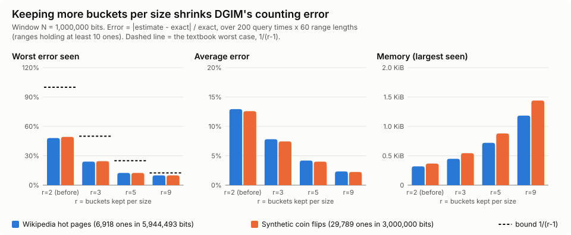

# Week 8: Streaming Sketches on Real Wikipedia Traffic

## Goal

Week 7 built four stream summaries (Bloom, Flajolet-Martin, AMS, DGIM) and
tested them on a generated stream.  This week runs the same four ideas on a
real, public stream of more than 1 GB: one full day of Wikipedia pageview
counts.  Every approximate answer sits beside the exact answer and its error.

## Dataset

| Item | Value |
| --- | --- |
| Source | Wikimedia Analytics hourly pageview dumps, <https://dumps.wikimedia.org/other/pageviews/> |
| License | CC0 1.0 public domain dedication ("All Analytics datasets are available under the Creative Commons CC0 dedication", stated on the [pageviews readme](https://dumps.wikimedia.org/other/pageviews/readme.html) and the [dumps legal page](https://dumps.wikimedia.org/legal.html), checked 2026-11-03) |
| Slice | 2026-10-27, hours 00-23 (UTC): 24 files `pageviews-20261027-HH0000.gz` |
| Size | 1,194,014,319 bytes gzipped (1.19 GB); 4,224,610,235 bytes (4.2 GB) uncompressed |
| Lines | 135,421,176 lines, 381,871,445 views, 0 malformed lines (the parser counts and skips any it finds) |
| Checksums | `manifest.json` next to the data lists url, bytes, and SHA-256 per file |

Each line is one page's view count for one hour:

```text
wiki_code page_title views 0
en.m Golden_Horn 9 0
```

`wiki_code` names the site (`en` = English Wikipedia desktop, `en.m` =
mobile), `page_title` uses underscores instead of spaces, and the last field is
always `0` (a retired response-size column).  A page appears at most once per
hour file, and lines are sorted by wiki and title, not by time.  The stream key
is `wiki_code + " " + page_title`; a line with `views = c` stands for c views.

### Why this data fits each algorithm

| Algorithm | Question on this data | Why it fits |
| --- | --- | --- |
| Bloom filter | Was a page read in hour 23 already read earlier that day? | About 48 million distinct keys arrive in hours 00-22; storing them all costs far more than a bit array. |
| Flajolet-Martin | How many different pages were read that day? | The same pages repeat every hour, so lines (135 million) far exceed distinct pages (49 million). |
| AMS | How concentrated are views on a few pages (second moment, the "surprise number")? | Views are very skewed: a few pages (Main Page, breaking news) get tens of thousands of views an hour, most get one. |
| DGIM | Among the last 1,000,000 lines, how many were "hot" (100+ views in that hour)? | Hot lines are rare (0.18% of lines in hour 00), giving a sparse 0/1 stream with a natural sliding window. |

### Download

```bash
python3 week-08/scripts/download_pageviews.py --dry-run          # HEAD only: URLs and total bytes
python3 week-08/scripts/download_pageviews.py --out-dir data/week-08/pageviews
```

Downloads are sequential (one file at a time), send the User-Agent
`big_data-coursework/1.0`, skip any file whose size already equals the
server's Content-Length, and resume a partial file with an HTTP Range request.
`data/` is ignored by Git; never commit the dumps.

## How the sketches run on this stream

`scripts/pageviews.py` reads each hour straight from gzip, one line at a time,
and hashes each key exactly once (64-bit BLAKE2b).  Each sketch takes what it
needs from that single hash, because 24 separate hashes per line (as the Week
7 classes do) would make 135 million lines far too slow in pure Python.

- **Bloom**: hours 00-22 insert, hour 23 only asks.  The k bit positions come
  from double hashing, `a + i*b` (a = low 32 bits, b = high 32 bits).  Sized
  for 60 million keys at a 1% target: 575,103,503 bits (71.9 MB), k = 7.
- **FM**: the low 12 bits pick one of 4,096 registers and the trailing zeros
  of the other 52 bits are the book's R ("stochastic averaging").  Registers
  combine with a harmonic mean and the HyperLogLog bias constant, the standard
  refinement when each key updates one register instead of all of them.
- **AMS**: the book's estimator on the *expanded* stream, where a line with c
  views is c arrivals, without expanding it.  Each of 4,096 variables keeps
  the arrival number of its next reservoir replacement (after a replacement at
  T, the next is at floor(T/U)+1).  A line covering arrivals n+1..n+c replaces
  every variable whose next arrival falls inside it, starting its count at the
  arrivals left in that line; later lines of the same page add their full c.
  The answer is the median of 8 group means (512 variables each).  We first
  tried 64 groups of 64; on a two-hour trial (hours 22-23) that was 36% low,
  because heavy pages are sampled so rarely that most small groups miss them
  and the median falls below the true mean.  Larger groups fixed it (0.9% on
  the same trial); this was chosen before the full-day run below.
- **DGIM**: bit = 1 when a line has 100+ views.  It uses `DGIMReduced` with
  r = 2 (the basic book algorithm, see below) and its `add_zeros`, which jumps
  over a run of zero bits in one step instead of 135 million single calls.
  Window N = 1,000,000 lines over all 24 hours.

The exact answers need every distinct key, 49 million.  One Python set or
dict holding all of them would need several GB (not run; this is the reason
for partitioning).  Instead the run writes (hash, views) pairs
to 64 partition files by the top 6 hash bits (16 bytes per line, about 2.2 GB of temporary disk)
and totals one partition at a time.  Keys are compared by their 64-bit hash;
with about 5e7 keys the chance of any collision is about n^2/2^65, roughly
1e-4.  Exact DGIM keeps the arrival times of the one-bits inside the window.

`tests/test_pageviews.py` proves the fast versions match Week 7 or exact math:
skipping zeros keeps exactly Week 7's DGIM buckets and estimates; weighted AMS picks the
same position and count as a brute-force replay on the expanded stream; the
inline loops give the same answers as the sketch classes; and a hand-made
three-hour dump gives hand-computed exact answers.

### Run

```bash
python3 week-08/scripts/run_pageviews.py \
  --input-dir data/week-08/pageviews --hours 00-23 \
  --output data/week-08/results/full-day.json --work-dir data/week-08/tmp
python3 week-08/scripts/run_pageviews.py --input-dir data/week-08/pageviews \
  --hours 12 --output runtime/week-08/hour-12.json     # quick one-hour check
```

On a machine with too little disk for the 2.2 GB of partition files (the
class head node), add `--skip-exact`: only the sketches run, no temporary
files are written, and every exact and error field is `null`.  Add
`--exact-from full-day.json` to copy the exact answers from an earlier full
run instead; it refuses unless the files, hours, lines and views match, and
records `estimates_match_reference`.  The seeds are fixed, so the estimates
match a desktop run number for number.

## Results: full day 2026-10-27

One run on one machine gives the accuracy, time and memory of every row:
[`scripts/time_algorithms.py`](scripts/time_algorithms.py) on a laptop (WSL2,
16 cores, Python 3.12.3).  Each sketch and each exact method makes its own
streaming pass over the 24 gzip files, alone in a fresh process, one after
another.  Nothing holds the day in memory.  Time is that pass's wall clock.
Memory is the peak resident memory the operating system reports for that
process.  Each pass ran once.  Full output:
[`results/full-day-per-algorithm.json`](results/full-day-per-algorithm.json).

| Algorithm | Estimate | Exact | Error | Sketch time | Exact time | Sketch peak memory | Exact peak memory |
| --- | ---: | ---: | ---: | ---: | ---: | ---: | ---: |
| Bloom | 4,258,683 | 4,254,618 | 0.10% | 506 s | 221 s | 87 MB | 142 MB |
| FM | 51,087,463 | 49,476,423 | 3.26% | 219 s | 237 s | 19 MB | 144 MB |
| AMS | 1.16742e13 | 1.16745e13 | 0.002% | 217 s | 257 s | 21 MB | 174 MB |
| DGIM | 564 | 461 | 22.3% | 186 s | 188 s | 19 MB | 19 MB |

The questions are in [Why this data fits each algorithm](#why-this-data-fits-each-algorithm).

How to read it:

- **Every pass pays to read the data.**  A pass that only reads, parses and
  hashes took 185 s at the start of the run and 189 s at the end, and peaked
  at 19 MB.  Subtract about 187 s to see what a method adds: about 30 s for
  FM and AMS, about 320 s for Bloom, and nothing we can measure for DGIM
  (its 186 s is inside the 4 s gap between the two baseline passes).
- **The exact side is the method we actually run at full scale.**  Bloom, FM
  and AMS write each line's hash to 64 partition files on disk, then total
  one partition at a time.  That adds 1.1 to 2.2 GB of temporary disk and
  keeps memory near 150 MB.  Exact DGIM keeps the positions of the hot lines
  inside the window, which is tiny.
- **Read this table for memory, not speed.**  The single-machine exact side
  uses Python's C-backed `set` and `dict` while the sketches are pure Python,
  so the time columns mostly measure the language.  The fair speed comparison
  is the pair of Hadoop jobs, FM and an exact count over the same input
  ([`scripts/hadoop/run-distinct-cluster.sh`](scripts/hadoop/run-distinct-cluster.sh)).
- **Memory is the win.**  19 MB is what any Python process here needs, so
  FM, AMS and DGIM add almost nothing: their summaries are 4 KB, 64 KB and
  224 bytes.  Bloom adds its 71.9 MB bit array.  The exact side needs about
  125 to 155 MB more than the baseline even after moving most of the work to
  disk, and its disk use grows with the data; the sketches do not grow.
- **Bloom is the slow sketch** because each key sets 7 bits one at a time in
  a Python loop.

The detail below (false positives, hourly DGIM checks) comes from the
combined run, `scripts/run_pageviews.py`: all four sketches in one pass, then
the exact answers from the partition files.  Its estimates and exact answers
are the same numbers as the table above.  Full output:
[`results/desktop-full-day.json`](results/desktop-full-day.json).  The same
code on the class cluster gave identical estimates; see
[Desktop vs. class cluster](#desktop-vs-class-cluster).

What the numbers say:

- **Bloom**: 78% of the 5,453,115 pages read in hour 23 had been read earlier
  that day.  There were 0 false negatives.  Among the 1,198,497 truly new
  pages, 4,065 were wrongly called "seen": a 0.34% false-positive rate, which
  matches the formula's 0.34% for 48,277,926 inserted keys.  It is below the
  1% target because the filter was sized for 60 million keys.
- **FM**: about 51 million different pages from 4,096 one-byte registers.  The
  expected error for 4,096 registers is about 1.6%, so 3.3% is a roughly
  two-standard-error miss on this one seed.
- **AMS**: the "surprise number" F2 = 1.17e13.  If the 381.9 million views
  were spread evenly over 49.5 million pages, F2 would be only 2.9e9.  Two
  random views land on the same page 0.008% of the time, as if all attention
  went to about 12,491 pages.  The plain mean of all 4,096 variables was 3.3%
  off; the median of 8 group means was 0.002% off (luck helps at that size).
- **DGIM**: hot lines are rare, so the counts are small and a percentage
  error looks large.  Across the 24 end-of-hour checks (last 1,000,000 lines
  each), the error ranged from 0.4% to 26.9%, inside DGIM's 50% guarantee.
  The stream order is dump order (sorted by wiki and title within each hour),
  not the order views happened.

## Desktop vs. class cluster

The same day was copied to the class head node (24 files, SHA-256 checked
against the desktop copies), kept gzipped, and streamed through the same code.
The head node has 4 cores, about 5 GB of free memory and 4.9 GB of disk in the
student home folder, so the run there used `--skip-exact` (no 2.2 GB of
temporary partition files) and copied the exact answers from the desktop run
with `--exact-from`.  It ran with `nice -n 19` under a 2 GB memory limit, one
process, and the head node's load stayed near 1 of 4 cores.

All four estimates on the head node (Bloom 4,258,683, FM 51,087,463, AMS
1.16742e13, DGIM 564) are identical to the desktop's.  We do not compare the
two machines' speed: they ran different Python versions on different core
counts, and the head-node run was throttled on purpose.

Identical estimates are expected: the seeds are fixed and the hash is
BLAKE2b, which does not change between machines or Python versions.  The
cluster run's JSON records `estimates_match_reference: true`.  Results:
[`results/cluster-full-day.json`](results/cluster-full-day.json),
progress log [`results/cluster-run.log`](results/cluster-run.log).

### FM as a Hadoop Streaming job

`scripts/hadoop/` runs the FM sketch as a real MapReduce job:

1. `fm_pageviews_mapper.py` hashes each page key once and prints only the
   registers it touched (at most 4,096 lines per hour file).
2. Hadoop sorts those lines by register number.
3. Week 7's `fm_reducer.py` keeps the largest value per register.
4. `fm_finish.py` turns the 4,096 merged registers into the estimate.  Week 7's
   Hadoop job stopped at the register array and never printed a count; this
   step closes that gap.

Students cannot write to HDFS yet (issue #19), so
`run-fm-pageviews-local.sh` runs Hadoop in local mode: input and output on
the head node's own disk, one JVM with a 512 MB heap, `nice -n 19`, no
cluster settings changed.  It refuses to overwrite earlier output.

| | Value |
| --- | --- |
| Map tasks | 24 (one per gzip file; gzip cannot be split) |
| Lines read by mappers | 135,421,176 |
| Lines sent through the shuffle | 98,304 (24 x 4,096), about 1,400 times fewer |
| Wall clock | 5 min 39 s |
| Estimate | 51,087,463.25, identical to the single-process sketch |

This is the point of FM in MapReduce: each mapper boils millions of lines
down to a few kilobytes, and the merge is just "take the max".  Summary log:
[`results/hadoop-fm-full-day.log`](results/hadoop-fm-full-day.log);
merged registers: [`results/hadoop-fm-full-day-registers.tsv`](results/hadoop-fm-full-day-registers.tsv).

```bash
bash week-08/scripts/hadoop/run-fm-pageviews-local.sh INPUT_DIR NEW_OUTPUT_DIR
```

## DGIM 4.6.6: reducing the error



### What the book says

DGIM counts the ones in the last N bits of a stream by keeping "buckets" of
sizes 1, 2, 4, 8, ... Week 7 used the basic rule: keep one or two buckets of
each size. Only the oldest bucket can stick out past the start of the range,
so the estimate counts it as half, and the answer can be off by up to 50%.

Section 4.6.6 lets each size keep r-1 or r buckets instead (sizes 1 and the
largest may keep 1 to r). When r+1 buckets of one size exist, the two oldest
merge into one bucket of double size, and that merge can ripple upward. With
more buckets of the smaller sizes, the one uncertain bucket is a smaller share
of the total, so the worst error falls to at most 1/(r-1). r=2 is the basic
algorithm.

### What we built and measured

- `scripts/dgim_reduced_error.py`: `DGIMReduced(window, r=2)`. Each size has
  its own queue, so a merge is a constant-time move, not a list rebuild.
  With r=2 it keeps exactly the same buckets and gives exactly the same
  estimates as Week 7's `DGIM` (tested step by step).
- `scripts/dgim_study.py`: one pass over each stream, every r side by side.
  Window N = 1,000,000 bits. 200 seeded query times x 60 range lengths k
  (log-spaced from 1 to N plus random ones), each compared with the exact
  count. Seed 4099.
- Real stream: one hour of Wikimedia pageviews
  (`pageviews-20261027-120000.gz`, 5,944,493 lines, sha256 `905b1795...`),
  one bit per line in file order, 1 when the page had at least 100 views:
  6,918 hot lines. Control stream: 3,000,000 seeded coin flips, p = 0.01.
- Every r is scored on the same queries: ranges holding at least 10 ones.
  The whole run takes about 8 seconds and 72 MB of RAM.

| r | Book worst case | Worst seen (Wikipedia / synthetic) | Average (Wikipedia / synthetic) | Buckets kept, max (Wikipedia / synthetic) |
| ---: | ---: | ---: | ---: | ---: |
| 2 (before) | 50% (basic analysis) | 48.1% / 49.3% | 12.9% / 12.6% | 20 / 23 (320 / 368 bytes) |
| 3 | 50% | 24.0% / 24.5% | 7.8% / 7.4% | 28 / 34 (448 / 544 bytes) |
| 5 | 25% | 12.5% / 12.5% | 4.2% / 4.0% | 45 / 55 (720 / 880 bytes) |
| 9 | 12.5% | 10.0% / 10.0% | 2.3% / 2.2% | 74 / 90 (1,184 / 1,440 bytes) |

Memory counts 16 bytes per bucket, as in Week 7. The 1/(r-1) bound held on
every scored query for every r, on both streams.

### The trade-off

Going from r=2 to r=9 cuts the average error about 5.5 times (12.9% to 2.3%)
and the worst error about 5 times, while the summary grows about 4 times
(20 to 74 buckets, still about 1 KiB for a million-bit window). Each step of
r buys less: the error falls like 1/r, while the memory grows like r.

**In one sentence:** keeping a few more buckets of each size lets DGIM
answer "how many in the last million?" within a few percent instead of within
half, for about a kilobyte of memory.

### A bug this found in Week 7

Week 7's estimate counted every in-range bucket in full, then added half of
the next bucket, whose bits had all expired. The book halves the oldest
in-range bucket instead. Example: eight ones, window 5, exact count 5. The
old rule said 8 (60% off, above the promised 50%); the book's rule says 6.
On this study's queries the old rule averaged 62% error, worst 197%. Week 7
now uses the book's rule, and its 10,000-event run moved from 46 (31.43%
error) to 38 (8.57%), exact 35. The study keeps the old rule only as a
labelled comparison (`week7_original_estimate`, Week 7 before the fix,
commit 141deb1). The full-day pageviews run reports it the same way
(`week07_before_fix_estimate`): for the last 1,000,000 lines it said 692
(exact 461, 50.1% off) where the book rule says 564; for the last 100,000 it
said 44 (exact 23) where the book rule says 28.

### Honest edge cases

- **Very small counts.** The book's argument assumes the half-counted bucket
  has size 2 or more. If it has size 1, the range holds at most r ones, and
  counting that single one as half can still be 50% off (for example, true
  count 1, estimate 0.5). This happened on 1,202 Wikipedia and 1,174
  synthetic queries, for every r. They are reported separately, not in the
  table. A common fix is to count a size-1 boundary bucket in full, since it
  is exact, but that is not the book's rule, so it was not applied.
- **The 1/(r-1) formula is loose at r=2.** It gives 100% there; the basic
  analysis in section 4.6.4 gives the tighter 50%, and we never saw more
  than 49.3%.
- The pageviews file is sorted by project and title, not by time, so "the
  last N lines" is a stand-in for "the last N events". It is still a real,
  bursty mix of hot and cold pages.

### Reproduce

```bash
# Download once (about 52 MB; the data folder is ignored by Git):
mkdir -p data/week-08/dgim-sample
curl -fL -A "big_data-coursework/1.0" \
  -o data/week-08/dgim-sample/pageviews-20261027-120000.gz \
  https://dumps.wikimedia.org/other/pageviews/2026/2026-10/pageviews-20261027-120000.gz

python3 week-08/scripts/dgim_study.py \
  --pageviews data/week-08/dgim-sample/pageviews-20261027-120000.gz \
  --output data/week-08/results/dgim-study.json \
  --chart week-08/docs/dgim-4.6.6.svg
```

Flags: `--window`, `--rs`, `--threshold`, `--query-times`, `--k-values`,
`--synthetic-length`, `--synthetic-p`, `--seed`, `--max-lines`. Leave out
`--pageviews` to run the synthetic stream alone.
