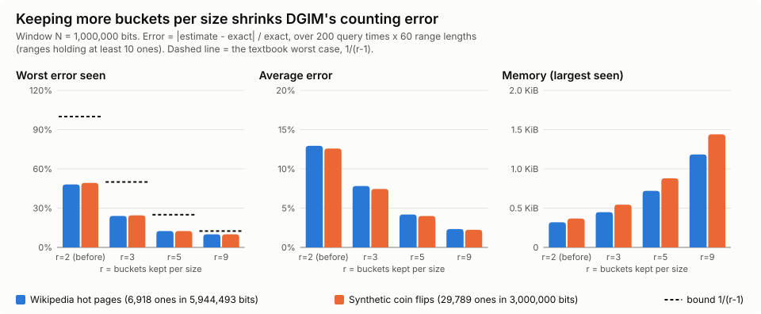

# Week 8: Streaming Sketches on Real Wikipedia Traffic

## What we did

Week 7 built four streaming algorithms and tested them on made-up click data. This week we gave them real data: one full day of Wikipedia pageviews. Each algorithm answers one question about that day using a small summary, and we compare every answer to the exact one.

## The dataset

Wikimedia publishes how many times every page was viewed, every hour, for free (CC0). We used all 24 hours of 2026-10-27.

- 24 files, 1.19 GB gzipped (4.2 GB unzipped)
- 135 million lines, 382 million views, 49 million different pages
- Each line is `site page_title views 0`, for example `en.m Golden_Horn 9 0`

It fits streaming well because the same pages show up again every hour, a few pages get almost all the views, and storing every page exactly takes hundreds of MB.

## Results

| Algorithm | Question | Estimate | Exact | Error | Memory used |
| --- | --- | ---: | ---: | ---: | ---: |
| Bloom filter | Was a page read in hour 23 already read earlier that day? | 4,258,683 yes | 4,254,618 | 0.10% | 72 MB instead of 386 MB |
| Flajolet-Martin | How many different pages were read? | 51,087,463 | 49,476,423 | 3.26% | 4 KB instead of 396 MB |
| AMS | How concentrated are views on a few pages? | 1.16742e13 | 1.16745e13 | 0.002% | 64 KB instead of 792 MB |
| DGIM | How many "hot" lines (100+ views) in the last million? | 564 | 461 | 22.3% | 224 bytes |

What each one tells us about Wikipedia:

- **Bloom:** 78% of the pages read in the last hour had already been read earlier that day. It never missed a page it had seen, and it wrongly said "seen" for only 0.34% of new pages.
- **FM:** about 50 million different pages were read in one day, counted with 4,096 one-byte registers.
- **AMS:** attention is very lopsided. Views are as concentrated as if everyone read only about 12,500 pages, out of 49 million.
- **DGIM:** really popular pages are rare. In the last million lines of the day only 461 had 100 or more views in their hour (about 1 in 2,000), and DGIM counted them with 224 bytes instead of storing a million bits.

## Desktop vs. the class cluster

We ran the same code on my desktop and on the class head node. The estimates were identical on both, because the hashes and seeds are fixed.

| | Desktop | Class head node |
| --- | --- | --- |
| Time for all four sketches | 5 min | 14 min |
| Peak memory | 305 MB (includes exact answers) | 92 MB (sketches only) |

We also ran FM as a Hadoop Streaming job on the head node. 24 mappers read all 135 million lines, but only 98,304 lines went through the shuffle, because each mapper only sends its 4,096 registers. The reducer takes the max of each register, and the final count matched the single-process answer exactly. Students can't write to HDFS yet (#19), so this ran in Hadoop's local mode on the head node's disk.

## DGIM: reducing the error (section 4.6.6)

Basic DGIM keeps 1 or 2 buckets of each size and can be off by up to 50%. Section 4.6.6 keeps r-1 or r of each size, which caps the error at 1/(r-1).

| r | Worst error | Average error | Memory |
| ---: | ---: | ---: | ---: |
| 2 (basic) | 48.1% | 12.9% | 320 bytes |
| 3 | 24.0% | 7.8% | 448 bytes |
| 5 | 12.5% | 4.2% | 720 bytes |
| 9 | 10.0% | 2.3% | 1,184 bytes |

Going from r=2 to r=9 cuts the error about 5 times for about 4 times the memory, which is still about 1 KB.

**A bug we found:** Week 7's DGIM estimate added half of a bucket that was already outside the window. With eight ones in a window of 5, it said 8 instead of the book's 6 (exact 5). We fixed it to the book's rule, and Week 7's own result moved from 31% error to 8.6%.

## What's next

- Noah is running the VM crash test (how much data it takes to run the VMs out of memory).
- A writable HDFS folder (#19) would let the Hadoop job run across all the workers instead of local mode.
